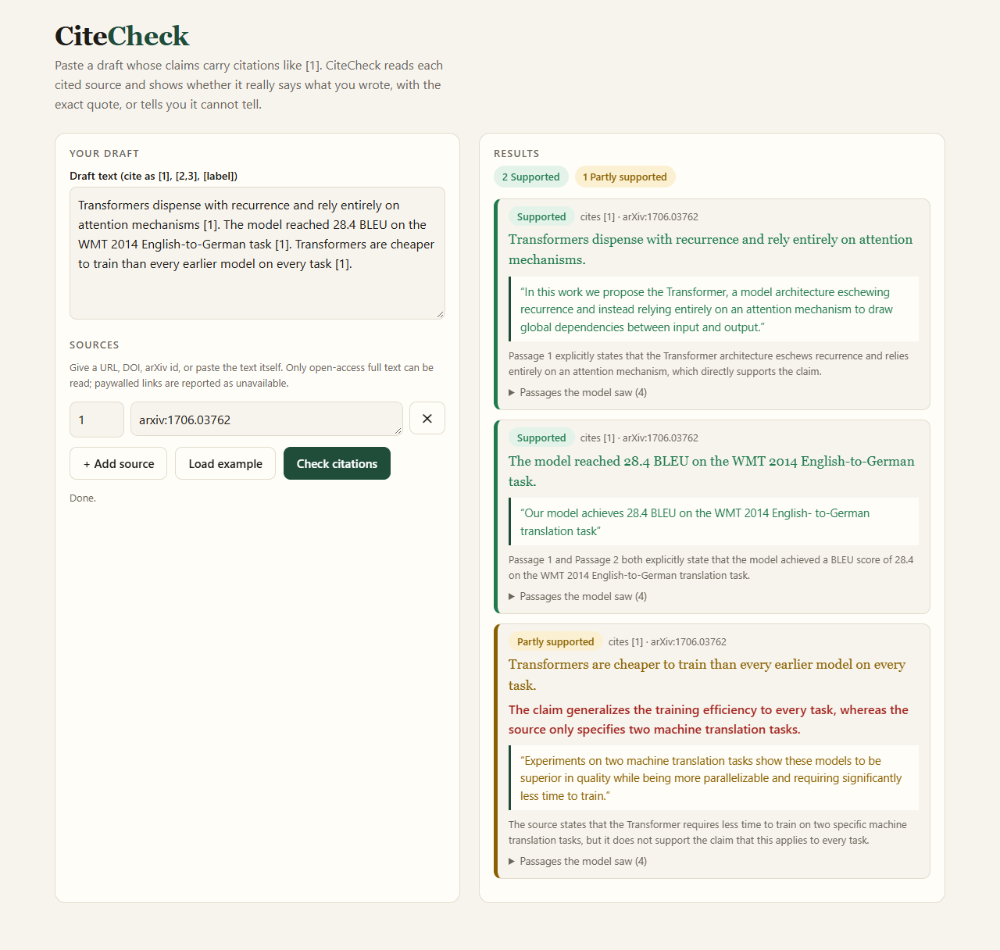
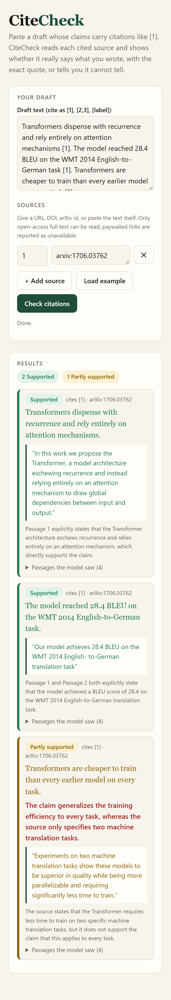

<div align="center">

# Cite**Check**

### Does your source actually say that?

**An AI citation verifier for student writers. It reads each source you cite, quotes the exact sentence that backs your claim, and tells you when it can't tell.**

[](#getting-started)
[](#technology-stack)
[](#how-the-ai-is-used)
[](#testing)
[](https://slayy-hacks.devpost.com/)



<p align="center">
<a href="#the-problem">Problem</a> ·
<a href="#the-solution">Solution</a> ·
<a href="#try-it-in-two-minutes">Quick start</a> ·
<a href="#how-it-works">How it works</a> ·
<a href="#evaluation">Evaluation</a> ·
<a href="#security-and-privacy">Security</a> ·
<a href="#limitations">Limitations</a> ·
<a href="#roadmap">Roadmap</a>
</p>

</div>

---

## At a glance

| Topic | Summary |
|---|---|
| **For** | Students and early-career researchers who cite papers in essays, theses and reports |
| **Does** | Checks each cited claim against the cited source and shows the evidence |
| **Key idea** | A verdict is only shown if its quote is verified word for word in the source; otherwise it says *can't verify* |
| **AI** | Google Gemini judges entailment; everything around it is deterministic, auditable code |
| **Status** | Working prototype, run locally. Evaluated on a public benchmark (preliminary). No hosted demo yet |

## Try it in two minutes

```bash
git clone https://github.com/Jean-Regis-M/citecheck.git && cd citecheck
python -m venv .venv && .venv/Scripts/activate      # macOS/Linux: source .venv/bin/activate
pip install -r requirements.txt
cp .env.example .env                                  # add your free Gemini key from aistudio.google.com
python -m uvicorn app.main:app --port 8000
```

Then open <http://localhost:8000>, click **Load example**, and click **Check citations**. You should see two *Supported* claims and one *Partly supported* claim, the last flagged for overstating what the paper shows.

---

## The problem

Students cite papers they have skimmed, remembered half-correctly, or only read the abstract of. The result is a quiet, common error: **a sentence that sounds right, carries a citation, and is not what the source says.** Typical patterns:

- a finding from *two* experiments is written as holding *in general*;
- a correlation becomes a cause;
- a number is copied wrongly or from the wrong population.

Reference managers check that a citation is *formatted* correctly. Plagiarism checkers look for *copied text*. Neither asks the question a careful reviewer asks: **does this source really support this sentence?** Reading every cited paper again is slow, so it rarely happens before submission.

## The solution

Paste a draft whose claims carry citations such as `[1]`, then give CiteCheck each source (an arXiv id, a DOI, a URL, or pasted text). For every cited claim it returns:

| Output | What it means |
|---|---|
| **Verdict** | Supported, partly supported, not supported, contradicted, or *can't verify* |
| **Evidence quote** | The exact sentence from the source, verified to appear word for word |
| **What's overstated** | A one-line explanation when a claim goes further than the source |
| **Passages the model saw** | Everything the verdict was based on, so you can check it yourself |

CiteCheck is a **pre-submission check for the writer**, not a grader. It shows its evidence, and when it is unsure it says so instead of guessing.

<div align="center">

<br><sub>The same results on a 390 px phone screen.</sub>
</div>

## What makes it different

Tools such as Scite already analyse how papers cite each other. CiteCheck takes a different, narrower angle: **a writer's own draft against the specific sources they cited, with the proof on screen.**

1. **Evidence or nothing.** A "supported" verdict must come with a quote. Code checks that the quote appears verbatim in the retrieved source text. If it does not, the verdict is withheld and shown as *can't verify*. The model cannot invent a supporting sentence and have it accepted.
2. **Honest abstention.** If only a paper's abstract was reachable, CiteCheck never says "the source doesn't support this", because absence of evidence in an abstract proves nothing. It says it can't verify.
3. **Overstatement detection.** The "partly supported" verdict targets scope, strength and number errors, the most common real citation mistake.
4. **Measured, not assumed.** The verification step is evaluated on a public benchmark ([results below](#evaluation)).

## How it works

```mermaid
flowchart LR
    D[Draft with citations<br/>"... [1]."] --> X[Claim extraction<br/>deterministic parser]
    S[Sources<br/>arXiv · DOI · URL · text] --> R[Safe fetcher<br/>SSRF-guarded, size-capped]
    R --> C[Chunk + BM25 index]
    X --> Q[Retrieve top passages<br/>per claim]
    C --> Q
    Q --> J[Gemini judge<br/>structured JSON verdict]
    J --> A{Audit: is the quote<br/>verbatim in a passage?}
    A -- yes --> O[Verdict + quote + issue]
    A -- no --> W[Withhold: can't verify]
    A -. abstract only .-> W
```

1. **Claim extraction (no AI).** Sentences carrying markers like `[1]`, `[2,3]`, `[1-3]` or `[smith2020]` are split out with a deterministic parser, so claim boundaries are predictable and testable.
2. **Source resolution.** arXiv ids become PDFs; DOIs go through OpenAlex to an open-access copy (falling back to the abstract, clearly labelled); URLs are fetched as HTML or PDF; text can be pasted.
3. **Retrieval.** Sources are split into overlapping passages and ranked with BM25 against each claim. Only the best passages are shown to the model.
4. **Judgement.** Gemini receives the claim and numbered passages, with the rule to use *only* those passages, treat them as untrusted data, quote exactly, and prefer *can't verify* when unsure. Output is constrained to a JSON schema.
5. **Audit.** Deterministic code verifies the quote and applies the abstention rules above before anything reaches the user.

## How the AI is used

| Aspect | Detail |
|---|---|
| **Model** | Google Gemini (configurable via `GEMINI_MODEL`), called over the REST API at temperature 0 |
| **Task** | Natural-language inference: does a passage entail, partly entail, or contradict a claim? |
| **Constrained output** | A JSON schema with an enumerated verdict, passage number, quote, issue and confidence |
| **What the AI does not do** | It does not find claims, fetch sources, rank passages, or decide whether its own quote is real. Those steps are ordinary code, so they can be tested and trusted |
| **Responsible-use measures** | Grounded-only judging; verbatim-quote audit; abstention instead of guessing; prompt-injection resistance (source text is treated as data); user-visible evidence; clear limitations |

A deterministic replacement would not work here: judging whether "28.4 BLEU on WMT 2014 English-to-German" and "cheaper to train than every earlier model on every task" are backed by a paper requires language understanding. The surrounding pipeline is kept deliberately non-AI so the model has one job and every answer can be audited.

## Evaluation

The verifier is evaluated on **SciFact** (Wadden et al., 2020), a public set of scientific claims labelled *supports*, *contradicts* or *not enough info* against paper abstracts. Each claim is run through the real retrieval, model and audit pipeline.

**Result** (`gemini-3.1-flash-lite`, 168 of 200 randomly sampled dev claims scored, seed 7):

| Measure | Result |
|---|---|
| Three-way accuracy | 82.7% (139 / 168) |
| Precision when it says "supported" | 88.9% (56 / 63) |
| Supported claims it recognised | 82.4% (56 / 68) |
| Unsupported claims wrongly passed as supported | 7.0% (7 / 100) |
| Model quotes rejected by the audit | 2 |

> **Read this carefully.** 32 of the 200 sampled claims could not be scored because the free Gemini tier's daily request limit was reached mid-run, so the margin of error is roughly plus or minus 6 points. Earlier smaller partial runs gave 85% (47 claims) and 76% (74 claims), a reminder of how much small samples swing. This is the small, fast "lite" model, used only because the free tier allows few calls to larger models; a stronger model has not been benchmarked. SciFact abstracts are short and clean, so long, messy papers are likely harder. The main errors are excess caution (10 supported claims labelled *can't verify*) and some wrong approvals (7 of 100 unsupported claims). Reproduce or extend the run with the command below.

```bash
python eval/run_scifact.py --data eval/data/scifact --n 200 --out eval/results/run.json
```

## Getting started

**Requirements:** Python 3.12 and a Gemini API key from [Google AI Studio](https://aistudio.google.com/).

```bash
git clone https://github.com/Jean-Regis-M/citecheck.git
cd citecheck
python -m venv .venv
.venv/Scripts/activate          # macOS/Linux: source .venv/bin/activate
pip install -r requirements.txt
cp .env.example .env            # then edit .env and add your key
```

Run the app:

```bash
python -m uvicorn app.main:app --port 8000
```

Open <http://localhost:8000>, click **Load example**, then **Check citations**.

### Configuration

| Variable | Default | Purpose |
|---|---|---|
| `GEMINI_API_KEY` | none | **Required.** Your Gemini key. Never commit `.env` |
| `GEMINI_MODEL` | `gemini-3.1-flash-lite` | Model used for verdicts |
| `RATE_LIMIT_PER_HOUR` | `10` | Checks allowed per visitor IP per hour |
| `MAX_CLAIMS` | `25` | Cited claims checked per request |
| `CONTACT_EMAIL` | empty | Optional, identifies you politely to OpenAlex |

Identical requests are cached on disk (`.cache/`), so re-checking an unchanged claim does not use API quota.

## Testing

```bash
python -m pytest -q
```

11 unit tests cover claim extraction (numeric, range and labelled markers), BM25 retrieval, passage chunking, verbatim-quote matching against PDF artefacts, withholding of fabricated quotes, the abstract-only rule, SSRF blocking, rate limiting and cache keys. These tests do not call the model. The model-dependent behaviour is covered by the benchmark above.

## Security and privacy

- **SSRF protection.** Source URLs must be `http(s)` on ports 80/443. Private, loopback, link-local and reserved addresses are blocked, and every redirect hop is re-validated. A response size cap bounds downloads.
- **Prompt injection.** Source text reaches the model only as quoted passages marked as untrusted data, and any verdict still has to survive the verbatim-quote audit.
- **Secrets.** The API key lives only in `.env` or the environment and is git-ignored.
- **Abuse control.** Per-IP hourly rate limit and input size limits.
- **Privacy.** Drafts and sources are sent to the Gemini API for judging, so do not paste confidential work. Nothing is stored apart from the local response cache.
- **Known gap.** The SSRF check resolves DNS before fetching; a DNS-rebinding attack in that gap is not mitigated.

## Limitations

- Reads **open-access** full text only. Paywalled sources are reported as unavailable; paste the text instead.
- Supports numbered and labelled markers (`[1]`, `[smith2020]`), not yet `(Author, Year)` style.
- Judges one claim against one source at a time; it does not follow arguments that span several sentences.
- Retrieval is lexical (BM25), so a claim phrased very differently from the source can miss the relevant passage and come back *can't verify*.
- It is a writing aid, not an authority. Verdicts can be wrong; the quote and passages are there so you can check.
- Preliminary evaluation only (see above): about 83% accuracy on a partial sample with the lite model, and 7 in 100 unsupported claims were wrongly passed. Free-tier Gemini quotas limit throughput.

## FAQ

**Why not just paste the paper into a general chatbot?**
You can, but a chatbot's answer is free text you have to trust. CiteCheck forces a structured verdict, retrieves the relevant passages for you, and refuses to show a "supported" verdict unless its quote is found verbatim in the source. The evidence is on screen to check, not a confident paragraph to believe.

**Does it tell me whether my claim is *true*?**
No. It only judges whether the *cited source* backs the claim. A true claim can be wrongly cited, and that is exactly what it is for.

**Is it a plagiarism or AI-text detector?**
No. It does not look at originality or authorship, and it does not grade work.

**What does "can't verify" mean?**
The source text was too short, too unrelated, unreachable, or the model's quote could not be confirmed. Treat it as "check this one by hand", not as an error.

**Is my draft stored?**
Not by the app, apart from a local cache of model responses. It is sent to the Gemini API to be judged, so avoid confidential material.

## Roadmap

Planned, **not yet implemented**:

- Full-sample benchmark run and error analysis (blocked only by free-tier API quota).
- `(Author, Year)` citation style support.
- Semantic retrieval alongside BM25 for claims phrased very differently from their source.
- Upload of PDF sources from the browser.
- A hosted demo with usage limits.

## Technology stack

| Layer | Choice |
|---|---|
| Backend | Python 3.12, FastAPI, Uvicorn, httpx, Pydantic |
| Parsing | pypdf, BeautifulSoup |
| Retrieval | Custom BM25 (no vector database needed at this scale) |
| AI | Google Gemini via REST, JSON-schema constrained output |
| Frontend | Single dependency-free HTML/CSS/JS page, light and dark themes, responsive |
| Testing | pytest; Playwright (screenshot tooling only) |

## Project layout

```
app/
  extract.py    claim extraction from cited sentences
  sources.py    safe fetching, PDF/HTML/DOI/arXiv resolution
  retrieve.py   chunking and BM25 ranking
  verify.py     judge prompt, schema and the quote audit
  pipeline.py   end-to-end orchestration
  llm.py        Gemini client with retries and caching
  main.py       FastAPI app and rate limiting
web/index.html  the interface
eval/           SciFact benchmark harness
tests/          unit tests
scripts/        screenshot tool
```

## Credits and licences

- Built by a first-time hackathon participant for [SLAY HACKS 2026](https://slayy-hacks.devpost.com/).
- Evaluation data: **SciFact**, Wadden et al., *Fact or Fiction: Verifying Scientific Claims*, EMNLP 2020 (not redistributed in this repository).
- Open-access lookup via [OpenAlex](https://openalex.org/); the example source is *Attention Is All You Need* (Vaswani et al., 2017) from arXiv.
- Code released under the [MIT License](LICENSE).
